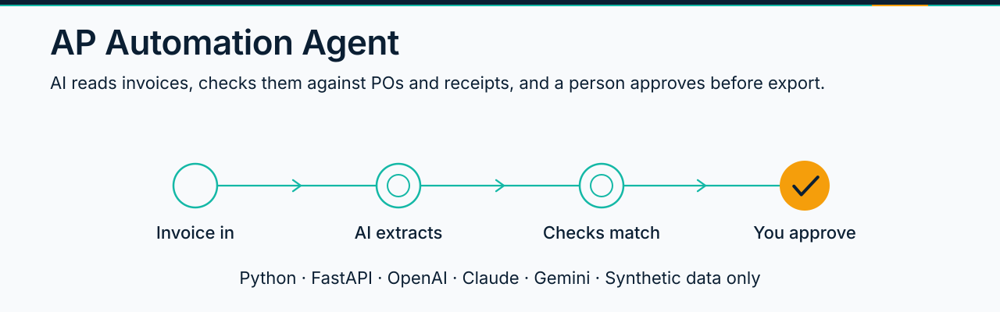
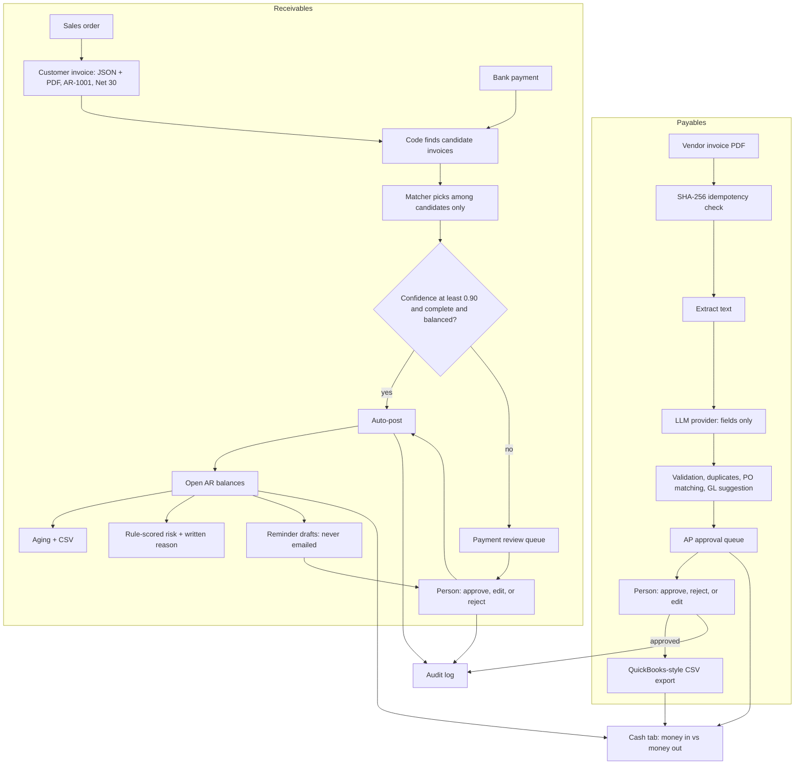

# AP Automation Agent

[](https://github.com/tishan-perera/ap-automation-agent/actions/workflows/ci.yml)

An AI-assisted finance-ops web app for **accounts payable (AP) and accounts receivable (AR)**. It does the repetitive work on both sides of the ledger and sends every exception to a person. **The model never invents a missing amount and never guesses a payment match:** anything it cannot read or match with confidence is stored as unknown, flagged, and put in a review queue.

All data in this repository is synthetic. Every vendor, customer, invoice, purchase order, and payment is fictional. Nothing is ever emailed.

## The problem

A small finance team spends much of the day on repetitive checks:

- **Payables:** reading vendor invoice PDFs, checking whether an invoice was already entered, matching it to a purchase order and a receiving record, coding it to a general ledger (GL) account, and preparing it for the books.
- **Receivables:** raising customer invoices, working out which invoice each incoming bank payment pays, keeping an aging report current, spotting customers who pay late, and writing collection reminders.

## The solution

The app handles the repetitive ~80% and leaves the judgement calls to a person:

- Clean work arrives already done: invoices extracted, matched, and coded; confident payments applied to the right invoices.
- Exceptions are explained in plain words: missing totals, duplicates, price or quantity variances, partial payments, overpayments, unidentified payments, and late payers.
- Anything uncertain waits in a review queue until a person decides, and every action is written to an audit log.

## Features

**Payables** (shipped in v1)

1. **Invoice PDF intake to structured JSON** via a swappable LLM provider, with schema validation and math checks.
2. **Duplicate detection**, exact (same vendor and invoice number) and soft (same vendor and total, dates within 3 days).
3. **2-way and 3-way matching** against purchase orders and receiving records, with a tolerance of the greater of $1.00 or 1% of the PO total.
4. **Suggested GL coding** with a confidence score and a written reason.
5. **Approval queue** with exception reasons, approve / reject / edit, and an audit log.
6. **QuickBooks-style CSV export** of approved invoices, one row per line item.

**Receivables** (added in Phases 9-15)

1. **Synthetic customers, sales orders, and a bank payment feed**, with an answer key for evaluation.
2. **Customer invoices from sales orders**, as JSON and PDF, numbered `AR-1001` upward, on Net 30 terms.
3. **AI cash application.** Code finds candidate invoices; the matcher only picks among them. A payment posts automatically only when confidence is at least 90% **and** it covers the invoices exactly. Partial payments, unclear splits, overpayments, and unidentified payments wait in a review queue.
4. **AR aging** in current / 1-30 / 31-60 / 61-90 / 90+ buckets, with a read-only CSV download.
5. **Late-payment risk flags** scored by fixed rules. The model only writes the plain-English reason and cannot change the score.
6. **Collection reminder drafts** in a polite, firm, or final tone. They wait for approval and are **never emailed**.

**Cash and navigation**

- **Payables / Receivables / Cash tabs**, and a **Cash** page showing money in versus money out and the next 30 days by due date, built only from stored invoices and payments.

## Screenshots

> **Placeholder: `docs/screenshots/queue.png` has not been captured yet.** The Payables approval queue.

> **Placeholder: `docs/screenshots/ap-exception.png` has not been captured yet.** The missing-total AP invoice, with Total shown as "—", not $0.

> **Placeholder: `docs/screenshots/ar-payment-review.png` has not been captured yet.** Receivables payment matching, with an overpayment and an unidentified payment waiting for a person.

> **Placeholder: `docs/screenshots/cash.png` has not been captured yet.** The Cash tab: money in, money out, and the 30-day list.

> **Placeholder: `docs/screenshots/reminder-draft.png` has not been captured yet.** A collection reminder draft waiting for review.

See [docs/screenshots/README.md](docs/screenshots/README.md) for how to capture them.

## Architecture



The model only turns text into fields, picks among candidate invoices, or writes wording. Every amount, match decision, score, and status is decided by plain, tested Python code. Stack: Python, FastAPI, Jinja2 + HTMX, SQLite, SQLAlchemy, Pydantic, pytest, ruff, and Docker Compose. Designs: [AP](docs/specs/design.md) and [AR](docs/specs/2026-11-21-ar-design.md).

## Quickstart (no API key needed)

```bash
git clone https://github.com/tishan-perera/ap-automation-agent.git
cd ap-automation-agent
docker compose up --build
```

Then open http://localhost:8000. On first start the app loads everything with the offline mock provider:
- 24 vendor invoices into the Payables queue
- 24 customer invoices, generated from sales orders
- 15 bank payments, matched with confident ones posted
- reminder drafts

(A rename of the repository to `ap-ar-automation-agent` is planned; until then, use the URL above.)

The synthetic invoices fall due between September and November 2026. Aging, risk, reminders, and the Cash page use today's date unless you set `AR_REPORT_AS_OF`, so on the Cash tab try an as-of date such as `2026-10-15` to see the 30-day list filled in.

## Local development (optional)

```bash
python3 -m venv .venv
source .venv/bin/activate
pip install -e ".[dev]"
cp .env.example .env
python scripts/generate_invoices.py   # only if data/invoices/ is missing
uvicorn app.main:app --reload
```

Then open http://127.0.0.1:8000/queue and use the Payables, Receivables, and Cash tabs.

If you ran the app before the AR tables were added, your local `data/app.db` is missing them (the log shows `db_schema_outdated`). It only holds synthetic demo data and is gitignored, so delete it and restart:

```bash
rm data/app.db
```

## Switching LLM providers

The default provider is `mock`: offline and deterministic. It parses the synthetic invoice template, matches payments with fixed rules, and writes reminder and risk wording from templates. It needs no key and makes no network calls.

To use a real model, set the provider and its key in `.env`:

```bash
LLM_PROVIDER=gemini           # mock | gemini | anthropic | openai
GEMINI_API_KEY=your-key       # or ANTHROPIC_API_KEY / OPENAI_API_KEY
```

If the matching key is missing, the app logs a warning and falls back to the mock. Model names can be changed with `OPENAI_MODEL`, `ANTHROPIC_MODEL`, and `GEMINI_MODEL` (see `.env.example`). The Settings page shows the current provider and whether each key is present, never the key itself.

## Safety

- **Synthetic data only.** No real invoices, vendors, customers, people, or employer data. Customer emails use the reserved `.example` domain.
- **Never invent amounts or matches.** Missing values stay null with a flag. A real model may only pick among candidate invoices the code found; anything else is thrown away. Payments post on their own only when they are confident, complete, and balanced. A model-written risk reason is replaced by a template if it adds a number that is not one of the facts, and model-written reminder sentences are replaced if they contain any number or amount (the invoice list and totals always come from code).
- **Human in the loop.** Every AP invoice waits for approval. Partial, split, overpaid, and unidentified payments wait for review. Reminder drafts wait for approval.
- **Nothing is ever emailed.** There is no SMTP, no mail API, and no send button. The database refuses a "sent" status, and a test fails if mail-sending code appears.
- **No secrets in the repo.** `.env` is gitignored, `.env.example` has empty keys, keys are never logged or stored in the database, and tests never call a real API.

## Tests and CI

```bash
pytest -q          # 267 tests, all using the mock provider or fakes
ruff check .
ruff format --check .
```

GitHub Actions runs ruff and pytest on every push and pull request ([workflow](.github/workflows/ci.yml)).

## Eval results

Both evals run on synthetic data with the **mock** provider. Every number below was printed by the scripts.

**Invoice extraction:** `python scripts/eval_extraction.py`, 24 invoices. Full report: [docs/eval-report.md](docs/eval-report.md).

| Field | Correct | Total | Accuracy |
|---|---|---|---|
| vendor_name | 24 | 24 | 100.0% |
| invoice_number | 24 | 24 | 100.0% |
| invoice_date | 24 | 24 | 100.0% |
| total | 24 | 24 | 100.0% |
| po_number | 24 | 24 | 100.0% |

A null where the ground truth is null counts as correct: refusing to guess a missing total is the right answer. The run had 2 correct refusals for `total`, 0 wrong guesses, and used 0 tokens. From the report: the mock is a parser written for this exact synthetic template, so these numbers show that the pipeline and scoring work; they are not a measure of real LLM accuracy.

**Cash application (payment matching):** `python scripts/eval_cash_application.py`, 15 bank payments. Full report: [docs/ar-matching-eval.md](docs/ar-matching-eval.md).

| Metric | Result |
|---|---|
| Status accuracy | 15/15 (100.0%) |
| Application accuracy (invoices and amounts) | 15/15 (100.0%) |
| Auto-posted / sent to review / left unidentified | 9 / 4 / 2 |

Leaving an unidentified payment unmatched counts as correct; guessing a customer or invoice counts as wrong. From the report: **the mock scored 100%, and that is not a measure of real AI accuracy.** The mock is a deterministic parser written for these synthetic memo formats.

**Real-provider eval: not run.** There was no Gemini (or other) API key in a local `.env` when these docs were written, so no real-model accuracy has been measured.

## Case study

**Automated:**
- **Payables:** text extraction, idempotent re-uploads, validation and line math, duplicate detection, 2-way and 3-way PO matching, GL suggestions with reasons, re-running every check after an edit, and the CSV export.
- **Receivables:** invoice creation with sequential numbers and PDFs, payment matching with auto-posting for confident and exact matches, balances and statuses kept in step with posted payments, aging, rule-based risk scores with written reasons, and reminder drafts.
- **Both:** the audit trail and the Cash view.

**Still needs a person:** approving every AP invoice; deciding whether a flagged duplicate is real; resolving price and quantity variances; entering totals that could not be read; reviewing partial payments, unclear splits, overpayments, and unidentified payments; deciding whether to use, edit, or reject each reminder draft (and sending it themselves, outside the app); and acting on risk flags.

**Known limits:**

- The real Gemini, Claude, and OpenAI providers are implemented but have not been run against the live APIs. Only the mock and test fakes are exercised in tests and evals.
- The mock parser and matcher understand only the synthetic formats in this repo.
- One local demo user; no login. SQLite only.
- AP matching compares invoice and PO totals plus received quantities, not line-by-line prices.
- Posted payments cannot be reversed in the app yet, and voiding an AR invoice is not built (the status exists).
- Two pending payment proposals can point at the same invoice; approval re-checks the open balance, so the second one is refused if it no longer fits.
- The risk weights were tuned on this synthetic data only.
- The Cash page shows AP bills as approved or exported; the app does not record paying them.
- `POST /export/csv` marks AP invoices exported. If that download is lost, the invoices are traceable in the audit log, but there is no re-download button yet.

## What I would do next

None of this is built today:

- Posting approved bills and payments to a QuickBooks Online sandbox instead of CSV files.
- Email intake for AP invoices (receiving only; the app would still never send email).
- Reversing a posted payment and voiding an AR invoice, both audited.
- A real-provider eval with a key, reported next to the mock numbers.

## More

- [Demo script](docs/demo-script.md): a 3-4 minute walkthrough
- [AP design spec](docs/specs/design.md) and [AR design spec](docs/specs/2026-11-21-ar-design.md)
- Eval reports: [extraction](docs/eval-report.md) and [cash application](docs/ar-matching-eval.md)
- [Brand style guide](docs/brand/dashboard-style.md)

MIT License. Built as a portfolio project.
