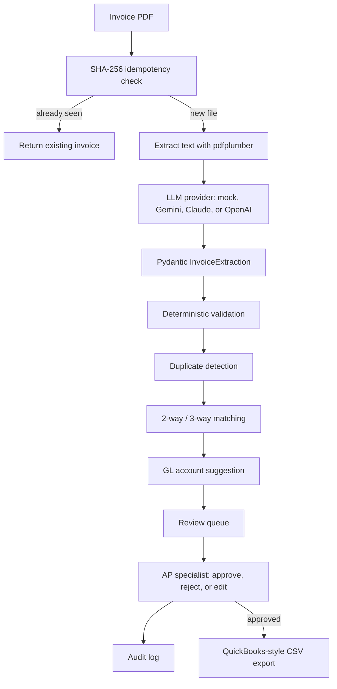

# AP Automation Agent

[](https://github.com/tishan-perera/ap-automation-agent/actions/workflows/ci.yml)

An AI-assisted accounts payable (AP) web app. It automates the repetitive part of invoice processing and sends every exception to a person. **The model never invents a missing amount:** an unreadable or absent total is stored as null, flagged, and sent to review.

All data in this repository is synthetic. Every vendor, invoice, and purchase order is fictional.

> **Roadmap: AP and AR.** This project is growing from AP-only into an AP and AR finance-ops agent. Accounts receivable (customer invoices, AI cash application, aging, risk flags, and collection-reminder drafts that are never emailed) is being added in phases. The design is in [docs/specs/2026-11-21-ar-design.md](docs/specs/2026-11-21-ar-design.md). **No AR feature works yet.** Everything below describes the AP features that are built and tested.

## The problem

AP specialists spend much of the day on repetitive checks: reading invoice PDFs, checking whether an invoice was already entered, matching it to a purchase order and a receiving record, coding it to a general ledger (GL) account, and preparing it for the books.

## The solution

The app handles that repetitive ~80% and leaves the judgement calls to a person:

- Clean invoices arrive already extracted, matched, and coded, so the specialist only confirms them.
- Exceptions (missing totals, duplicates, price or quantity variances, unknown POs, vendor mismatches) are listed in plain words at the top of each invoice.
- Nothing is exported until a person approves it, and every action is written to an audit log.

## Features (v1)

1. **Invoice PDF intake to structured JSON** via a swappable LLM provider, with schema validation and math checks.
2. **Duplicate detection**, exact (same vendor and invoice number) and soft (same vendor and total, dates within 3 days).
3. **2-way and 3-way matching** against purchase orders and receiving records, with a tolerance of the greater of $1.00 or 1% of the PO total.
4. **Suggested GL coding** with a confidence score and a written reason (vendor map first, then line-description keywords, otherwise "needs manual coding").
5. **Approval queue dashboard** with exception reasons, approve / reject / edit, and an audit log.
6. **QuickBooks-style CSV export** of approved invoices, one row per line item.

## Screenshots

> **Placeholder: `docs/screenshots/queue.png` has not been captured yet.**
> The approval queue with the "Needs review" filter, showing invoices with and without exceptions.

> **Placeholder: `docs/screenshots/invoice-happy.png` has not been captured yet.**
> A clean invoice's detail page: extracted fields, a "matched" PO panel, and the GL suggestion.

> **Placeholder: `docs/screenshots/invoice-exception.png` has not been captured yet.**
> The missing-total invoice: the exception at the top and the Total field shown as "—", not $0.

## Architecture



The model only turns text into fields. Every check after that (validation, duplicates, matching, GL coding) is plain, tested Python code. Stack: Python, FastAPI, Jinja2 + HTMX, SQLite, SQLAlchemy, Pydantic, pytest, ruff, and Docker Compose. Full design: [docs/specs/design.md](docs/specs/design.md).

## Quickstart (no API key needed)

```bash
git clone https://github.com/tishan-perera/ap-automation-agent.git
cd ap-automation-agent
docker compose up --build
```

Then open http://localhost:8000. On first start the app loads the sample purchase orders and ingests the 24 synthetic invoices with the offline mock provider, so the queue is already populated.

## Local development (optional)

```bash
python3 -m venv .venv
source .venv/bin/activate
pip install -e ".[dev]"
cp .env.example .env
python scripts/generate_invoices.py   # only if data/invoices/ is missing
uvicorn app.main:app --reload
```

Then open http://127.0.0.1:8000/queue.

## Switching LLM providers

The default provider is `mock`: an offline, deterministic parser for the synthetic invoice template. It needs no key and makes no network calls.

To use a real model, set the provider and its key in `.env`:

```bash
LLM_PROVIDER=anthropic        # mock | gemini | anthropic | openai
ANTHROPIC_API_KEY=your-key    # or GEMINI_API_KEY / OPENAI_API_KEY
```

If the matching key is missing, the app logs a warning and falls back to the mock. Model names can be changed with `OPENAI_MODEL`, `ANTHROPIC_MODEL`, and `GEMINI_MODEL` (see `.env.example`). The Settings page shows the current provider and whether each key is present, never the key itself.

## Safety

- **Synthetic data only.** No real invoices, vendors, people, or employer data.
- **Never invent amounts.** Missing or unreadable values stay null with a flag such as `MISSING_TOTAL`. The prompt to real providers says to return null rather than guess, and an invoice with no total cannot be approved until a person enters one.
- **Human in the loop.** Every invoice, even a clean one, waits for a person to approve, reject, or edit it. Approved invoices are locked.
- **No secrets in the repo.** `.env` is gitignored, `.env.example` has empty keys, keys are never logged or stored in the database, and tests never call a real API.

## Tests and CI

```bash
pytest -q          # 118 tests, all using the mock provider
ruff check .
ruff format --check .
```

GitHub Actions runs ruff and pytest on every push and pull request ([workflow](.github/workflows/ci.yml)).

## Eval results

Produced by `python scripts/eval_extraction.py` on the 24 synthetic invoices with the **mock** provider. Full report: [docs/eval-report.md](docs/eval-report.md).

| Field | Correct | Total | Accuracy |
|---|---|---|---|
| vendor_name | 24 | 24 | 100.0% |
| invoice_number | 24 | 24 | 100.0% |
| invoice_date | 24 | 24 | 100.0% |
| total | 24 | 24 | 100.0% |
| po_number | 24 | 24 | 100.0% |

A null where the ground truth is null counts as correct: refusing to guess a missing total is the right answer. The run had 2 correct refusals for `total`, 0 wrong guesses, and used 0 tokens.

**Read these numbers carefully.** The mock is a parser written for this exact template, so 100% shows that the pipeline and scoring work end to end. It is not a measure of real LLM accuracy, which has not been evaluated here.

## Case study

**Automated:** text extraction and field parsing, idempotent re-uploads (same file bytes return the same invoice), schema and line-math validation, exact and soft duplicate detection, 2-way and 3-way PO matching with tolerance, GL suggestions with reasons, re-running every check after a human edit, the audit trail, and the CSV export.

**Still needs a person:** approving every invoice, deciding whether a flagged duplicate is real, resolving price and quantity variances with the vendor or the receiving team, entering totals that could not be read, and coding invoices the vendor map and keywords cannot place.

**Known limits:**

- The real Gemini, Claude, and OpenAI providers are implemented but have not been run against the live APIs. Only the mock is exercised in tests and the eval.
- The mock parser understands only the synthetic invoice template.
- One local demo user; no login. SQLite only.
- Matching compares invoice and PO totals plus received quantities, not line-by-line prices.
- `POST /export/csv` marks invoices exported when it runs. If that download is lost, the invoices are traceable in the audit log, but there is no re-download button yet. (`GET /export/csv` is a read-only preview.)

## What I would do next

None of this is built today:

- Accounts receivable (AR): designed in [docs/specs/2026-11-21-ar-design.md](docs/specs/2026-11-21-ar-design.md) and being built in phases. Not working yet.
- Posting approved bills to a QuickBooks Online sandbox instead of a CSV file.
- Email intake, so invoices sent to an AP inbox are ingested automatically.

## More

- [Demo script](docs/demo-script.md): a 2-3 minute walkthrough
- [Design spec](docs/specs/design.md)
- [Eval report](docs/eval-report.md)

MIT License. Built as a portfolio project.
