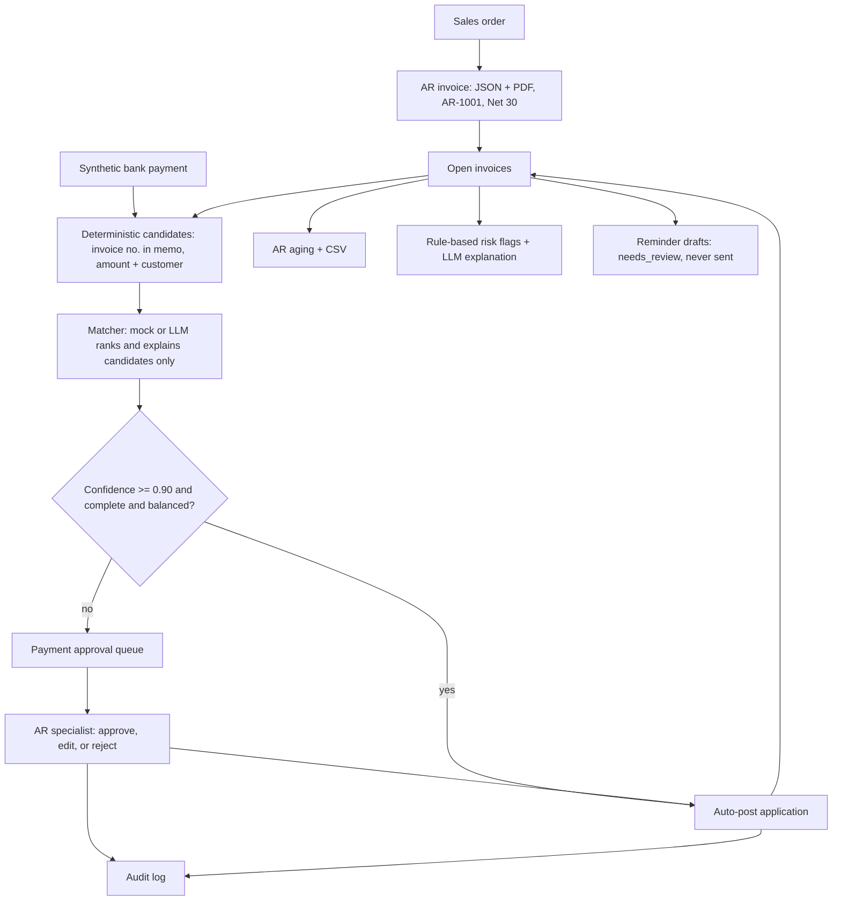

# AR Design Spec: AP and AR Finance-Ops Agent

Date: November 21, 2026
Owner: Tishan Perera
Status: Source of truth for accounts receivable (AR), Phases 9-16. The AP design stays in [design.md](design.md).

## 1. Problem and goal

The app already automates the repetitive part of accounts payable. A small finance team also spends its day on the other side of the ledger: raising customer invoices, working out which invoice each incoming payment pays, chasing late payers, and keeping an aging report current.

Goal: one app for payables and receivables. AI handles the repetitive work, and **a person still approves every exception**. As on the AP side, the model never guesses a payment match and never invents an amount, customer, or invoice. When the data is not clear enough, the item goes to the approval queue with a plain-English reason.

## 2. Users and principles

Primary user: an AP/AR specialist on a small team. One local demo user (`ap-specialist`) is enough. No login and no SSO.

Principles, carried over from AP:

- Human in the loop: anything uncertain waits for a person. Approve, edit, and reject actions are audited.
- Deterministic checks live in code. The model ranks, explains, and drafts wording. It does not decide amounts or scores.
- Mock provider by default, so the app and every test run with no API key.
- Synthetic data only. Fictional customers. Email addresses use only `.example` domains, or are null.
- Nothing is ever emailed.

## 3. Scope

In scope:

1. **Synthetic AR data:** customers, sales orders, and a bank payment feed (JSON fixtures written by a generator script).
2. **Customer invoice creation** from sales orders, as JSON and PDF, with sequential numbers (`AR-1001`, `AR-1002`, and so on) and Net 30 terms.
3. **AI cash application:** match incoming bank payments to open AR invoices.
4. **AR aging** with buckets and a CSV export.
5. **Late-payment risk flags** per customer.
6. **AI-drafted collection reminders** that wait for approval and are never sent.
7. **A combined Cash dashboard** and **Payables / Receivables / Cash tabs**.

Out of scope:

- Sending any email: no SMTP, no mail API, and no send button that actually sends.
- Live bank feeds.
- Live QuickBooks or any live books write.
- SSO or user accounts.
- Production cloud deploy.
- Real customer, vendor, employer, or personal data.

## 4. Architecture and reuse

Reused as-is or extended without breaking AP:

| Existing piece | Path | AR use |
|---|---|---|
| Swappable LLM providers (mock, Gemini, Claude, OpenAI), factory, retry with backoff | `app/services/llm/` | Same providers and keys. AR adds a small separate `PaymentMatcher` interface (and later a reminder-wording interface), so `BaseProvider.extract` and its AP tests stay unchanged. |
| Text normalization | `app/services/normalize.py` | Payer-to-customer and memo matching |
| Audited review actions and `ReviewError` | `app/services/review.py` | Same pattern for payment applications and reminders |
| GET preview vs POST action export | `app/services/export.py`, `app/routers/export.py` | AR aging CSV: GET is a read-only download. Any export that changes state uses POST. |
| Idempotent seeding and startup bootstrap | `app/services/seed.py`, `app/services/demo.py` | Seed customers, orders, and bank payments without overwriting rows |
| Validation flags | `app/services/validation.py` | Same `{code, message, field}` shape for AR exceptions |
| Generator and eval script patterns | `scripts/generate_invoices.py`, `scripts/eval_extraction.py` | AR data generator and cash-application eval |
| pytest, ruff, CI | `tests/`, `.github/workflows/ci.yml` | Unchanged workflow |

AP invoices stay in the existing `invoices` table. AR uses only new tables, so no AP query, test, or fixture changes.

## 5. Data model

SQLAlchemy 2.x. Money columns are `Decimal` (`Numeric(14, 2)`; quantities `Numeric(14, 4)`). Primary keys are UUID strings. Timestamps are UTC.

### customers
- id, name, account_number (unique)
- billing_email (fictional `.example` domains only, or null)
- payment_terms (default `Net 30`), notes, created_at

### sales_orders
- id, order_number (unique), customer_id (FK customers)
- order_date, currency (default USD), status, expected_total

### sales_order_line_items
- id, order_id (FK sales_orders), description, quantity, unit_price, amount

### ar_invoices
- id, invoice_number (unique, sequential like `AR-1001`)
- customer_id (FK), sales_order_id (FK, nullable)
- invoice_date, due_date, currency
- subtotal, tax, total, amount_paid, balance
- status: `draft | open | partial | paid | void`
- pdf_path, created_at, updated_at

### ar_invoice_line_items
- id, ar_invoice_id (FK), description, quantity, unit_price, amount

### bank_payments
- id, payment_date, amount, currency, memo, payer_name_raw
- status: `unmatched | needs_review | posted | unidentified`
- confidence (nullable float), match_details (JSON), created_at

### payment_applications
- id, payment_id (FK), ar_invoice_id (FK, nullable only for `unidentified`)
- amount_applied, confidence
- match_kind: `invoice_number | amount_and_customer | split | partial | overpayment | unidentified`
- posted_at (null until posted), approved_by (null for auto-posts; the actor otherwise)

### ar_risk_flags
- id, customer_id (FK), score (int), level (`low | medium | high`)
- rule_codes (JSON list), explanation, as_of_date, created_at

### collection_reminders
- id, customer_id (FK), tone (`polite | firm | final`)
- subject, body
- status: `needs_review | approved | rejected`
- approved_by, created_at, updated_at

**There is no `sent` status**, because nothing is ever emailed. Approving a reminder means "the wording is approved". A person copies it out manually if they want to use it.

Invariants (enforced in code and tested):

- `balance = total - amount_paid`, and is never negative.
- Status follows the balance: `open` when nothing is paid, `partial` when 0 < amount_paid < total, `paid` when the balance is 0. `void` is set only by a person.
- The sum of a payment's posted applications never exceeds the payment amount.

## 6. Audit log

Keep `audit_events.invoice_id` working for AP. Add two nullable columns:

- `subject_type`: `ar_invoice | bank_payment | payment_application | collection_reminder | customer`
- `subject_id`: the id of that row

Existing AP events (ingested, approved, rejected, edited, exported) keep writing `invoice_id` and leave both new columns null. No backfill, so AP behaviour, tests, and the AP detail page's audit log stay exactly the same. AR events set `subject_type` and `subject_id` and leave `invoice_id` null.

AR actions to audit include: `ar_invoice_created`, `ar_invoice_voided`, `payment_auto_posted`, `payment_application_approved`, `payment_application_edited`, `payment_application_rejected`, `reminder_drafted`, `reminder_approved`, `reminder_edited`, `reminder_rejected`, and `aging_exported`.

## 7. Customer invoice creation

- Created from a sales order. Line items are copied from the order lines, and amounts are computed in code: `amount = quantity x unit_price`, rounded to cents.
- `subtotal` is the sum of line amounts. `tax` is 0.00 in v1, because the synthetic orders carry no tax rate; the column is kept for later. `total = subtotal + tax`. If the computed total does not match the order's `expected_total`, the invoice is created as `draft` with a flag instead of `open`. Totals are never inferred to make them agree.
- **Numbering:** `AR-` followed by the highest existing number plus 1, starting at `AR-1001`, computed inside the same transaction. The unique constraint is the backstop. Void invoices keep their number, so there are no gaps and no reuse.
- **Terms:** the customer's `payment_terms`, default Net 30. `due_date = invoice_date + 30 days`.
- **Outputs:** a JSON representation (API response) and a PDF rendered with reportlab in the same visual style as the AP fixture generator. PDFs are written to `data/ar_invoices/`, which is generated at runtime and added to `.gitignore` in Phase 10.

## 8. Cash application rules

1. **Deterministic candidates first** (code, no model):
   - An `AR-` invoice number found in the memo, matching an open invoice.
   - Otherwise, an exact amount that equals one open invoice's balance, for the customer whose normalized name matches `payer_name_raw`.
   - Otherwise, combinations of the same customer's open invoices that sum exactly to the payment (a possible split).
2. **The matcher (mock or LLM) only ranks and explains** the candidates the code produced. Its output is validated: every invoice id must be an existing open invoice from the candidate list, and the applied amounts must reconcile with the payment. Anything that fails validation, or a payment with no candidates, becomes `unidentified`. **Never invent a customer or invoice.**
3. **Auto-post only when all of these hold:** confidence is at least **0.90**, and the application is complete and balanced (the full payment is applied, nothing is left over, and nothing is overpaid).
4. **Always sent to the approval queue:** partial payments, unclear splits, overpayments, and unidentified payments. These get status `needs_review` or `unidentified`, with `match_details` explaining why.
5. Posting updates `amount_paid`, `balance`, and status on each invoice in one transaction, and writes an audit event.

The mock matcher is a deterministic parser of the synthetic memo formats. It makes no network calls.

## 9. AR aging

- Buckets by days past due: `current` (not yet due), `1-30`, `31-60`, `61-90`, `90+`.
- Days past due = `report_as_of - due_date`, using open and partial invoices and their `balance`.
- Every aging and risk function takes an explicit `as_of: date`, so tests can set it. The demo uses an optional `AR_REPORT_AS_OF` setting (default: today in UTC), so the synthetic dates stay meaningful.
- CSV export: per-invoice rows plus customer and bucket totals. `GET` is a read-only download, following the AP export pattern.

## 10. Risk flags

Score with deterministic rules first. The initial weights are below and will be finalized by tests in Phase 13:

| Rule code | Condition | Points |
|---|---|---|
| `OLDEST_PAST_DUE_1_30` / `_31_60` / `_61_90` / `_90_PLUS` | Oldest open invoice's days past due | 0 / 20 / 40 / 60 |
| `MULTIPLE_30_PLUS` | Each open invoice 30+ days past due | +15 each, capped at 30 |
| `PARTIAL_PAY_PATTERN` | Two or more partial payments in the last 90 days | +10 |

Level: `low` under 25, `medium` 25-49, `high` 50 or more.

The LLM only writes a plain-English explanation from the rule codes and their inputs. It must not change the score or level. A test asserts that the stored score equals the rule score, whatever the explanation says. The mock writes a template explanation.

## 11. Collection reminders

- One draft per customer who has past-due invoices. Regenerating does not create a second draft while one is still `needs_review`.
- **Tone** comes from the oldest past-due age: `polite` for 1-30 days, `firm` for 31-60, and `final` for 61 or more.
- The past-due invoice list (invoice numbers, due dates, balances) is rendered by code. The model writes only the surrounding wording, so it cannot invent an amount or an invoice.
- Drafts wait in the queue as `needs_review`. Approve, edit, and reject are audited.
- **No SMTP, no mail API, and no send button.** Approved drafts stay in the app.

## 12. UI plan

- Payables / Receivables / Cash tabs, the Cash dashboard, and the AR queues are built in **Phase 15**, in the brand style.
- Earlier phases may add JSON or HTML routes, but must not break `GET /` (which redirects to `/queue`) or the existing AP queue tests.
- The Cash dashboard shows totals computed from data only: open AP awaiting approval, AR open balance by aging bucket, and payments needing review. No invented metrics.

## 13. Brand

- Colors: navy `#0B1F33` (text and authority), teal `#14B8A6` (automation accent, lines and fills, never text on light), amber `#F59E0B` **only for items that need a human** (needs review, pending approval), paper `#F8FAFC` (background).
- Type: Inter for UI text, and JetBrains Mono (tabular numbers) for amounts, numbers, and invoice numbers.
- Light, calm layouts: white cards, thin borders, 12px radius, 8px grid.
- The style guide is in [docs/brand/dashboard-style.md](../brand/dashboard-style.md), and fonts are self-hosted in `app/web/static/fonts/`. Nothing references paths outside the repo.

## 14. Testing and evals

- pytest never calls a real API. The autouse fixture in `tests/conftest.py` already forces the mock provider and blanks every key.
- New AR tests follow the AP style: unit tests on pure functions, then end-to-end tests on the synthetic fixtures.
- **Cash-application eval** (`scripts/eval_cash_application.py`) scores matches against a ground-truth answer key (`data/ar/ground_truth.json`). Correctly leaving an unidentified payment unmatched counts as correct. Guessing a match counts as wrong.
- Report only numbers the script actually produced. If the mock scores 100%, the report must say that the mock is a deterministic parser of the synthetic memos, not a measure of real AI accuracy.

## 15. Local database note

A local `data/app.db` created during AP-only work will not have the new AR tables or the new audit columns. `create_all` adds missing tables but does not alter existing ones. The file is gitignored and holds only synthetic data, so **deleting it and restarting the app is enough**. The startup bootstrap recreates and repopulates it. No migration framework is added.

## 16. Proposed file tree and phase map (Phases 9-16)

| Phase | Work | Main new files |
|---|---|---|
| 9 | Synthetic AR fixtures and cash-application answer key (no database rows, no PDFs) | `scripts/generate_ar_data.py`, `data/ar/customers.json`, `data/ar/sales_orders.json`, `data/ar/planned_invoices.json`, `data/ar/bank_payments.json`, `data/ar/ground_truth.json`, `tests/test_generate_ar_data.py` |
| 10 | AR models, audit `subject_type` and `subject_id`, seeding from `data/ar/`, and customer invoices (numbering, JSON, PDF) | `app/models_ar.py`, `app/services/ar/seed.py`, `app/services/ar/invoicing.py`, `app/services/ar/numbering.py`, `app/services/ar/pdf.py`, `tests/test_ar_models.py`, `tests/test_ar_invoicing.py` |
| 11 | Cash-application engine: candidates, matcher, auto-post rule | `app/services/ar/candidates.py`, `app/services/ar/cash_app.py`, `app/services/llm/payment_matcher.py`, `tests/test_cash_application.py` |
| 12 | Payment approval queue and posting | `app/services/ar/posting.py`, `app/routers/ar.py`, `tests/test_ar_posting.py` |
| 13 | AR aging, aging CSV, risk flags | `app/services/ar/aging.py`, `app/services/ar/risk.py`, `tests/test_ar_aging.py`, `tests/test_ar_risk.py` |
| 14 | Collection reminder drafts and review | `app/services/ar/reminders.py`, `tests/test_reminders.py` |
| 15 | Payables / Receivables / Cash tabs, Cash dashboard, brand restyle | `app/web/templates/ar_*.html`, `app/web/templates/cash.html`, `app/web/static/styles.css`, `tests/test_ar_dashboard.py` |
| 16 | Cash-application eval, README and demo-script update | `scripts/eval_cash_application.py`, `docs/cash-app-eval-report.md`, `tests/test_cash_app_eval.py` |

File names are a proposal. Each phase keeps files small and focused, and confirms names when it starts.
