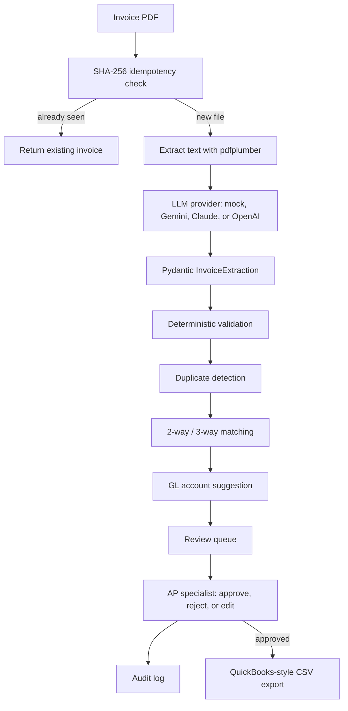

# AP Automation Agent — Design Spec (v1)

Date: November 20, 2026
Owner: Tishan Perera
Status: v1 build spec for a same-day public portfolio project

## 1. Problem and goal

Accounts payable specialists spend much of the day on repetitive work: reading invoice PDFs, checking whether an invoice was already entered, matching it to a purchase order (and to a receiving record when one exists), coding it to a general-ledger account, and preparing it for the books.

This application automates that repetitive ~80%. An AP specialist still approves exceptions and can edit, reject, or approve each invoice. The app must never invent a missing amount. If a field is unreadable or absent, store null, add a flag, and send the invoice to the review queue.

Accounts receivable is out of scope for v1.

## 2. Users and principles

Primary user: an AP specialist on a small team.

Principles:
- Human-in-the-loop: nothing is exported as approved unless a person approves it.
- Deterministic checks live in code, not in the model.
- The mock LLM provider is the default, so anyone can run the repo with no API key.
- Synthetic data only. No real invoices, employer data, vendor data, or personal data.
- One-command run: docker compose up --build.

## 3. Scope (v1)

In scope:
1. Invoice PDF intake to structured JSON via an LLM, with schema validation.
2. Duplicate detection (exact and soft).
3. 2-way and 3-way matching against sample POs and receiving records, with tolerance rules.
4. Suggested GL coding with confidence and a reason.
5. Approval queue dashboard: exception reasons, approve / reject / edit, audit log.
6. Export approved invoices to a QuickBooks-style CSV.

Out of scope for v1:
- Accounts receivable
- Live QuickBooks Online or any live books write
- Email inbox or Gmail OAuth
- User login / SSO (a single local demo user is enough)
- Production cloud deploy
- Mobile-native apps
- Real vendor master data

## 4. Architecture

Mermaid:

Components and files:
- app/main.py — FastAPI app, health, API, HTML routes
- app/config.py — settings from the environment
- app/db.py — SQLite engine and session
- app/models.py — SQLAlchemy tables
- app/schemas.py — Pydantic extraction and API schemas
- app/logging_setup.py — structured JSON logs
- app/services/pdf_extract.py — text extraction
- app/services/llm/ — provider factory and providers
- app/services/validation.py — flags; never invent amounts
- app/services/ingest.py — orchestration and idempotency
- app/services/duplicates.py
- app/services/matching.py
- app/services/gl_coding.py
- app/services/export.py
- app/services/seed.py
- app/web/ — Jinja2 + HTMX dashboard
- scripts/generate_invoices.py
- scripts/eval_extraction.py

## 5. Data model

Use SQLAlchemy 2.x. Money fields are Decimal. Primary keys are UUID strings. Timestamps are UTC.

### invoices
- id (str, PK), filename (str), file_hash (str, unique)
- status (str): needs_review | approved | rejected | exported
- vendor_name, invoice_number, invoice_date, due_date, po_number (all nullable)
- currency (str, default USD)
- subtotal, tax, total (Decimal, nullable — never coerce missing to 0)
- raw_text (str), extracted_json (JSON)
- validation_flags (JSON list of {code, message, field})
- exception_reasons (JSON list of strings)
- is_duplicate (bool, default false), duplicate_of_id (str, nullable)
- duplicate_kind (str, nullable): exact | soft
- match_type (str, nullable): two_way | three_way | none
- match_status (str, nullable): matched | variance | missing_po | missing_receipt | vendor_mismatch | not_applicable
- match_details (JSON)
- gl_account, gl_account_name (str, nullable)
- gl_confidence (float, nullable), gl_reason (str, nullable)
- created_at, updated_at, approved_at, exported_at (nullable datetimes)
- approved_by (str, nullable; demo default "ap-specialist")

### invoice_line_items
- id, invoice_id (FK), description, quantity, unit_price, amount (Decimals nullable)

### purchase_orders
- id, po_number (unique), vendor_name, po_date, currency, status (open | closed), expected_total

### po_line_items
- id, po_id (FK), description, quantity, unit_price, amount

### receiving_records
- id, po_number, received_date, packing_slip_number

### receiving_line_items
- id, receiving_id (FK), description, quantity_received

### audit_events
- id, invoice_id, at, actor, action, before_json, after_json, note

### processed_files
- file_hash (PK), invoice_id, processed_at

### app_settings
- key (PK), value — store llm_provider here if switched in the UI. Never store API keys.

## 6. Extraction schema

Pydantic model InvoiceExtraction:
- vendor_name, invoice_number, invoice_date, due_date, po_number: optional
- currency: default "USD"
- subtotal, tax, total: Optional[Decimal] — missing stays None, never 0
- line_items: list of {description, quantity, unit_price, amount}, each optional
- extraction_notes: optional str

## 7. Data flow

1. A PDF is uploaded, or all fixture PDFs are ingested.
2. SHA-256 of the file bytes is computed. If processed_files already has that hash, return the existing invoice and do not call the LLM.
3. Text is extracted with pdfplumber, falling back to pypdf if the text is empty.
4. The configured provider returns InvoiceExtraction JSON.
5. Validation runs in code. Missing or unreadable amounts stay null. Line math is checked.
6. Duplicate detection runs against existing invoices.
7. Matching runs against purchase orders and receiving records.
8. A GL account is suggested.
9. exception_reasons is built from flags. Any blocking flag sets status to needs_review. In v1, even a clean invoice still requires a human approval before export.
10. The specialist approves, rejects, or edits. Each action writes audit_events.
11. Approved invoices can be exported once. Status becomes exported.

## 8. Validation flag codes

MISSING_TOTAL, MISSING_INVOICE_NUMBER, MISSING_VENDOR, MISSING_DATE, LINE_MATH_MISMATCH, UNREADABLE, EXTRACTION_FAILED, DUPLICATE_EXACT, DUPLICATE_SOFT, MISSING_PO, PRICE_VARIANCE, QTY_VARIANCE, VENDOR_MISMATCH, MISSING_RECEIPT, LOW_CONFIDENCE_EXTRACTION.

## 9. Matching and tolerance

- Amount match: within the greater of USD 1.00 or 1% of the PO total (both configurable via AMOUNT_TOLERANCE_USD and AMOUNT_TOLERANCE_PCT).
- 2-way: invoice vs purchase order (normalized vendor, PO number, amounts).
- 3-way: when a receiving record exists for the PO, invoiced quantity must exactly match quantity received, otherwise QTY_VARIANCE.
- If a PO exists but no receiving record, match_type is two_way. If amounts match, do not fail only because a receipt is missing. Record a note in match_details that 3-way was not possible, unless you are specifically testing qty_variance fixtures that include a receipt.
- Vendor and invoice number: trim, lowercase, and strip punctuation before compare.

## 10. Duplicate rules

- Exact: same normalized vendor + same normalized invoice number.
- Soft: same normalized vendor + same total + invoice_date within 3 days + different invoice number.
- Do not silently drop a duplicate. Save it, link duplicate_of_id, flag it, and send it to review.

## 11. GL coding

Chart of accounts (credit is always 2000 Accounts Payable):
- 6100 Office Supplies
- 6200 Software and Subscriptions
- 6300 Professional Services
- 6400 Facilities and Rent
- 6500 Travel and Meals
- 6600 Utilities
- 6700 Marketing

Suggest from a vendor-to-account map first (high confidence, reason cites the vendor map). If unknown, use line-description keywords, then a conservative lower-confidence fallback with a clear reason.

## 12. Error handling

- Missing amount or total: null + MISSING_TOTAL. Never guess.
- Line items do not add to total (within USD 0.01): LINE_MATH_MISMATCH.
- Unreadable PDF: UNREADABLE, fields null, needs_review.
- LLM timeout, 429, or 5xx: retry up to 3 times with 1s, 2s, 4s backoff. After 3 failures, save the invoice with EXTRACTION_FAILED and needs_review.
- Other 4xx: do not retry; same failed path.
- Structured logs include invoice id, file_hash, provider, elapsed_ms, token usage (0 for mock), and outcome. Never log API keys.
- .env is gitignored. .env.example has empty keys.

## 13. LLM providers

- mock (default): a deterministic parser of the synthetic PDF template. Tests always use mock. No network calls.
- gemini, anthropic, openai: real structured-output calls only when a key is present.
- Switch with LLM_PROVIDER in .env, or store the provider name in app_settings. Keys never go in the database or the UI.
- Prompts to real providers must say: if a number is missing or unreadable, return null; never guess or invent amounts.

## 14. Testing and evals

- pytest for unit and API tests. No test may call a real LLM API.
- ruff lint and format.
- GitHub Actions runs ruff and pytest on push and pull_request.
- scripts/eval_extraction.py scores the synthetic set field-by-field. A null total on a missing-total fixture is a correct refusal, not an error.
- Report only numbers the eval script actually produced.

## 15. Portfolio artifacts

README (problem, solution, mermaid architecture, Docker quickstart, eval numbers, case study, limits), this design spec, CLAUDE.md, screenshots, a 2-3 minute demo script with one success path and one failure path, and an eval report.
